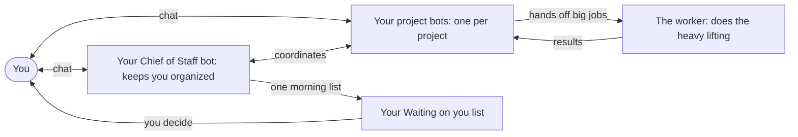
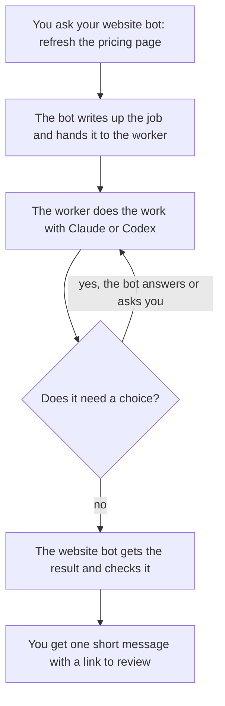
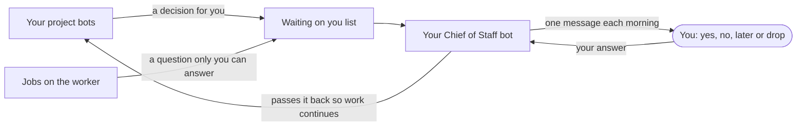

# agent-swarm-kit

Set up your own team of AI helpers. You chat with a few Grok Bot bots that plan and keep you organized,
and (if you want) an always-on computer in the cloud does the long, heavy work for them with Claude Code
and Codex, on the subscriptions you already pay for.

## What you get

- **A Chief of Staff bot.** One bot you talk to about everything. It keeps track of what needs you and
  sends you one short list of decisions each morning.
- **A project bot for each project.** A business, a website, an app. Each one owns its project from end
  to end and knows its goals, people and limits.
- **A worker that does the heavy lifting (optional).** A worker is a rented server (a computer in the
  cloud that is always on). It runs long jobs, code changes, research and anything that needs a strong or
  specific AI model, while you sleep if you like.
- **Results that come back to the right bot.** When a job finishes, the bot that asked for it gets the
  result directly. No middleman bot reading everything.
- **One "Waiting on you" list.** Every decision that needs you lands in one place. You can answer, snooze
  or drop each one. Dropping is fine.
- **Light rules.** Nothing goes outside, nothing is deleted, and no money is spent without your yes.
  Everything else just gets done.

## Two ways to run it

- **Grok Bot only.** No server. Good for non-technical people. Your bots plan, draft, research and keep
  you organized. [Start here](docs/grokbot-only.md).
- **Grok Bot plus a worker.** A small rented server runs long jobs, code changes, and anything that needs
  a specific or high-end model. Good for developers and heavy users. [Start here](docs/worker-setup.md).

You can start with the first and add a worker later. Nothing has to be redone.

## How it works, in pictures

### Who does what



Your bots are the managers. They talk with you, plan, and write up jobs. The worker is the doer: it uses
Claude Code and Codex to do the long or hard work.

### A day in the life of a request



The result goes back to the same bot that asked. If the worker gets stuck on a question, that bot
answers it, or asks you if only you can decide. The work then picks up where it stopped.

### Where decisions land



Developers who want the full technical view (states, tokens, routing rules) can read
[how it works, technical](docs/how-it-works-technical.md).

## Who it is for

- People who already use Grok Bot and want several bots to work as one team.
- Developers who want agents to make pull requests overnight while they sleep, and wake up to a short list
  of decisions.
- Anyone who wants AI help without paying per use: the default runs on the Claude and ChatGPT
  subscriptions you already have.

## Trust model

This kit is for **one trusted owner** (you) running a **dedicated worker** (a server used only for this).
The bots are your own bots. It is not a shared service for strangers. Within that:

- One job on the worker cannot read or change another job.
- A project bot cannot see or act on another bot's jobs.
- Jobs never hold the worker's long-lived key or your GitHub login. The worker itself pushes code and
  opens draft pull requests after checking the rules.

Details are in [secrets](docs/secrets.md).

## Quick start

### Path 1: Grok Bot only (no server, about an hour)

1. Create a Chief of Staff bot. Paste [templates/chief-of-staff.md](templates/chief-of-staff.md) into its
   instructions.
2. Create one project bot. Fill in [templates/project-bot-brief.md](templates/project-bot-brief.md) as its
   brief.
3. Add the morning and nightly routines from [templates/routine-prompts.md](templates/routine-prompts.md).
4. Read [docs/grokbot-only.md](docs/grokbot-only.md) for what works, what does not, and how to add a
   worker later.

### Path 2: Grok Bot plus a worker (about half a day)

You will type commands on the server. The CLI (command line interface, a program you run by typing) for
the swarm is called `swarmctl`. A token is a long random password that a bot or program uses to prove who
it is. Tailscale is a private network that links your own devices, so nothing has to be open to the
whole internet.

1. Rent an Ubuntu LTS server (4 vCPU, 8 GB to start). See [docs/worker-setup.md](docs/worker-setup.md).
2. Get the kit onto the server. If you have no copy there, download a release file, or pack your own
   copy with `git archive` and send it with `scp` (secure copy). For a private repo, use a read-only key,
   never your own GitHub login. All three ways are in
   [docs/worker-setup.md](docs/worker-setup.md), step 2.
3. If the server gave you only `root`, pick a name for your own admin user (a normal login with sudo).
   The script makes it for you with `--admin-user NAME`. Later steps turn off root login, so you need it.
4. Run the setup script:

   ```bash
   sudo bash scripts/setup-worker.sh --admin-user NAME --tailscale later
   ```

   **Heads up: without `--tailscale later` the script stops at the Tailscale step and waits** (up to
   15 minutes) until you open the link it prints and approve the server. That is fine if you are at the
   screen. With `--tailscale later` nothing waits; you join afterwards with `sudo tailscale up --ssh`.
   `--no-tailscale` skips Tailscale fully, but then public SSH can never be closed (step 7).
5. When the script has finished, log in to Claude Code and Codex as the `agent` user (the user that runs
   the AI jobs), and GitHub as the `swarm-runner` user (the user that pushes code; the jobs themselves
   never get your GitHub login). Then start the worker and run the smoke test (a quick check that
   everything is in place):

   ```bash
   sudo -iu agent claude            # then /login
   sudo -iu agent codex login --device-auth
   sudo -u swarm-runner -H gh auth login
   sudo -u swarm-runner -H gh auth setup-git
   sudo systemctl start swarm-worker
   sudo bash scripts/smoke-test.sh
   ```

   On a new box, expect `0 failed` with up to 2 warnings (GitHub login, Tailscale) until you do those.
6. Join Tailscale if you have not yet, and let your bots reach the worker. The recommended way: put
   Tailscale on your bot's computer and use Tailscale Serve on the worker, so it is never on the public
   internet ([docs/worker-setup.md](docs/worker-setup.md)). Then register each bot's own inbox
   ([templates/bot-setup-checklist.md](templates/bot-setup-checklist.md)).
7. Close public SSH (remote login from the internet) once you can log in as your admin user over
   Tailscale: `sudo bash scripts/setup-worker.sh --lockdown`.
8. Follow the [first week walkthrough](docs/first-week.md) to take one task from start to finish.

**Honest note (tested on):** version 0.2.1 passed a clean install on a fresh Ubuntu 24.04 server on
2026-11-18: setup, smoke test, admin user, firewall and SSH hardening, lockdown refusal checks, and the
task and cleanup flow. Not yet tested on a real server: joining Tailscale (so the real lockdown, Tailscale
Serve and Tailscale SSH), Claude and Codex login, running a model task, GitHub login and repo pushes, and
bot notify delivery. Version 0.2.0 had bugs that 0.2.1 fixed. Run `scripts/smoke-test.sh` after setup
and tell us what fails.

## What is in the box

| Folder | What it holds |
| --- | --- |
| [docs/](docs/) | How everything works and how to set it up |
| [templates/](templates/) | Bot instructions, project brief, setup checklist, routine prompts, model routing table, review prompt, task brief |
| [server/](server/) | The task tracker, the worker, the `swarmctl` command line, cleanup, the `with-secrets` helper, service files |
| [scripts/](scripts/) | Setup script for a fresh server, smoke test, backup, disk alert, secret scanner, restart when idle |
| [config/swarm.env.example](config/swarm.env.example) | The one settings file, with placeholders only |
| [tests/](tests/) | Tests: `python3 -m unittest discover -s tests` |

Everything on the server uses only Python 3 and its standard library, with SQLite for storage. There is
no web dashboard on purpose; `swarmctl status` shows what matters on one screen. Running the task tracker
on Cloudflare instead of the worker is a design only, not built.

## Docs

Start with the concepts, then follow your path.

- [Concepts](docs/concepts.md): bots, tasks, states, reports, the Waiting on you list.
- [Grok Bot only setup](docs/grokbot-only.md): no server needed.
- [Worker server setup](docs/worker-setup.md): any provider, Tailscale, and the security baseline.
- [Sizing and sandboxes](docs/sizing-and-sandboxes.md): how big a server, and when to offload tests.
- [How it works, technical](docs/how-it-works-technical.md): diagrams for developers.
- [Backend](docs/backend.md): the task tracker, its API and who can call what.
- [Results routing](docs/results-routing.md): straight to the owner bot, with a fallback.
- [Model routing](docs/model-routing.md): which model for which job.
- [Approvals](docs/approvals.md): a light default you can loosen.
- [Secrets](docs/secrets.md): the trust model, where keys live, and the `with-secrets` helper.
- [Usage and cost](docs/usage-and-cost.md): keep bots quiet and spend low.
- [Optional services](docs/optional-services.md): GitHub, Tailscale, treg, Executor, email inboxes, the
  multi-subscription proxy.
- [Routines](docs/routines.md): morning decisions, nightly memory cleanup, result handling.
- [First week](docs/first-week.md): one task end to end.
- [Updating the kit](docs/updating-the-kit.md): pull improvements and send yours back.
- [Troubleshooting](docs/troubleshooting.md).

## The rules in one breath

Bots plan, the worker works. Results go to the bot that owns the task. Nothing goes outside, nothing is
deleted, and no money is spent without your yes; another bot's yes does not count. Secrets never go in
chat. Bots stay quiet unless something changed. Anything for you lands on one list, and dropping an item
from it is fine.

## Version

See [VERSION](VERSION) and [CHANGELOG.md](CHANGELOG.md). License: [LICENSE](LICENSE) (private, all rights
reserved).
