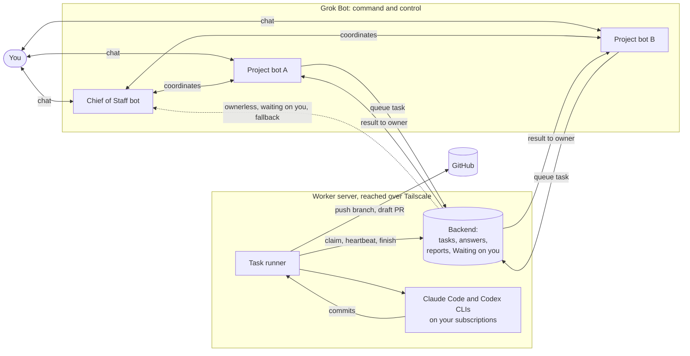
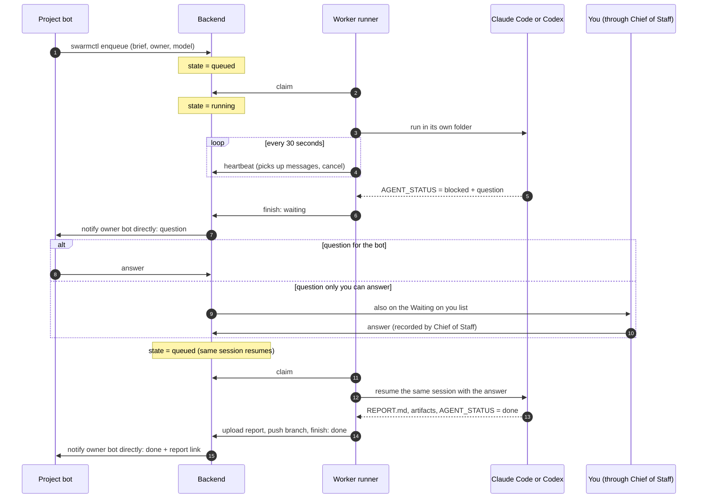
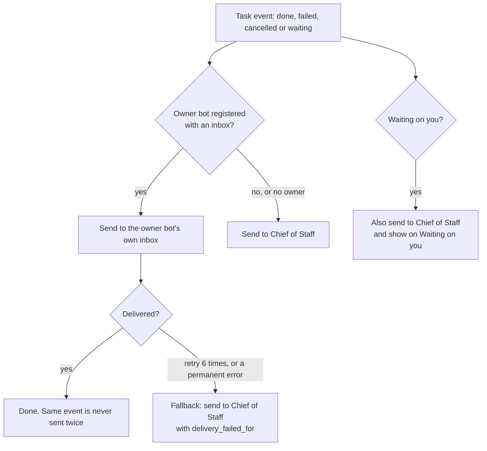

# agent-swarm-kit

Set up your own swarm of AI agents: a team of Grok Bot bots that plan and coordinate, and an always-on
server (the "worker") that does the real work with Claude Code and Codex on your own subscriptions.

This kit gives you the instructions, templates and code to run it. It works in two ways:

- **Grok Bot only.** No server. Good for non-technical people. Your bots plan, draft, research and keep
  you organized. [Start here](docs/grokbot-only.md).
- **Grok Bot plus a worker.** A small rented server runs long jobs, code changes, and anything that needs
  a specific or high-end model. Good for developers and heavy users. [Start here](docs/worker-setup.md).

You can start with the first and add a worker later. Nothing has to be redone.

## Who it is for

- People who already use Grok Bot and want several bots to work as one team.
- Developers who want agents to make pull requests overnight while they sleep, and wake up to a short list
  of decisions.
- Anyone who wants AI help without paying per token: the default runs on the Claude and ChatGPT
  subscriptions you already have.

## How it works

You talk to one bot, the **Chief of Staff**. Each project (a business, a website, an app) gets its own
**project bot** that owns that project end to end. The bots are the managers. They do not do long work.
They write it down as a **task** and send it to the **worker**.

The worker is a server you rent (about 4 CPUs and 8 GB of memory to start). It runs a small **backend**
that stores every task, and a runner that picks up tasks and runs them with the Claude Code or Codex
command line tools (CLI means command line interface). When a task finishes, or needs an answer, the
backend tells the bot that owns it, directly.



### The life of a task



### Where results go

Results go straight to the bot that owns the task. The Chief of Staff is not a hub; routing everything
through one bot wastes tokens. It only hears about tasks with no owner, questions that need you, alerts,
and deliveries that failed.



## Quick start

### Path 1: Grok Bot only (no server, about an hour)

1. Create a Chief of Staff bot. Paste [templates/chief-of-staff.md](templates/chief-of-staff.md) into its
   instructions.
2. Create one project bot. Fill in [templates/project-bot-brief.md](templates/project-bot-brief.md) as its
   brief.
3. Add the morning and nightly routines from [templates/routine-prompts.md](templates/routine-prompts.md).
4. Read [docs/grokbot-only.md](docs/grokbot-only.md) for what works, what does not, and how to add a
   worker later.

### Path 2: Grok Bot plus a worker (about half a day)

1. Rent an Ubuntu LTS server (4 vCPU, 8 GB to start). See [docs/worker-setup.md](docs/worker-setup.md).
2. Copy this repo onto it and run the setup script:

   ```bash
   sudo bash scripts/setup-worker.sh
   ```

3. Log in to Claude Code, Codex and GitHub as the `agent` user, then start the worker:

   ```bash
   sudo -iu agent claude            # then /login
   sudo -iu agent codex login --device-auth
   sudo -iu agent gh auth login
   sudo systemctl start swarm-worker
   sudo swarmctl status
   ```

4. Let your bots reach the backend ([docs/backend.md](docs/backend.md)) and register each bot's own inbox
   ([templates/bot-setup-checklist.md](templates/bot-setup-checklist.md)).
5. Close public SSH once Tailscale works: `sudo bash scripts/setup-worker.sh --lockdown`.
6. Follow the [first week walkthrough](docs/first-week.md) to take one task from start to finish.

## What is in the box

| Folder | What it holds |
| --- | --- |
| [docs/](docs/) | How everything works and how to set it up |
| [templates/](templates/) | Bot instructions, project brief, setup checklist, routine prompts, model routing table, review prompt, task brief |
| [server/](server/) | Backend, worker runner, `swarmctl` command line, cleanup, systemd service files |
| [scripts/](scripts/) | Setup script for a fresh server, backup, disk alert, secret scanner |
| [config/swarm.env.example](config/swarm.env.example) | The one settings file, with placeholders only |
| [tests/](tests/) | Tests for the backend and worker: `python3 -m unittest discover -s tests` |

The backend and worker use only Python 3 and its standard library, with SQLite for storage.
There is no web dashboard on purpose; `swarmctl status` shows what matters on one screen.

## Docs

Start with the concepts, then follow your path.

- [Concepts](docs/concepts.md): bots, tasks, states, reports, the Waiting on you list.
- [Grok Bot only setup](docs/grokbot-only.md): no server needed.
- [Worker server setup](docs/worker-setup.md): any provider, plus the security baseline.
- [Sizing and sandboxes](docs/sizing-and-sandboxes.md): how big a server, and when to offload tests.
- [Backend](docs/backend.md): the on-worker default, the API, and the Cloudflare option.
- [Results routing](docs/results-routing.md): straight to the owner bot, with fallback and no duplicates.
- [Model routing](docs/model-routing.md): which model for which job.
- [Approvals](docs/approvals.md): a light default you can loosen.
- [Secrets](docs/secrets.md): where keys live and how bots handle them.
- [Usage and cost](docs/usage-and-cost.md): keep bots quiet and spend low.
- [Optional services](docs/optional-services.md): GitHub, Tailscale, treg, Executor, email inboxes, the
  multi-subscription proxy.
- [Routines](docs/routines.md): morning decisions, nightly memory cleanup, result handling.
- [First week](docs/first-week.md): one task end to end.
- [Updating the kit](docs/updating-the-kit.md): pull improvements and send yours back.
- [Troubleshooting](docs/troubleshooting.md).

## The rules in one breath

Bots plan, the worker works. Results go to the bot that owns the task. Nothing goes outside, nothing is
deleted, and no money is spent without your yes; another bot's yes does not count. Secrets never go in
chat. Bots stay quiet unless something changed. Anything for you lands on one list, and dropping an item
from it is fine.

## Version

See [VERSION](VERSION) and [CHANGELOG.md](CHANGELOG.md). License: [LICENSE](LICENSE) (private, all rights
reserved).
