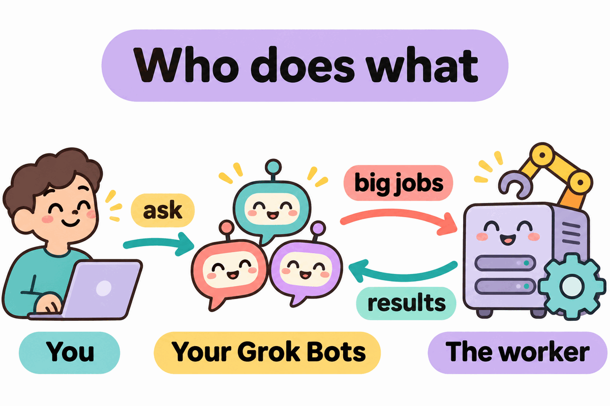
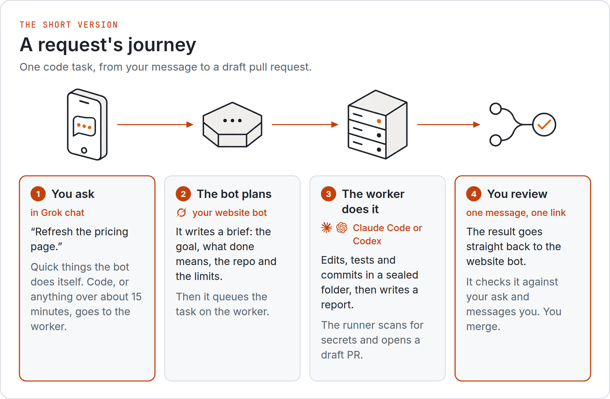
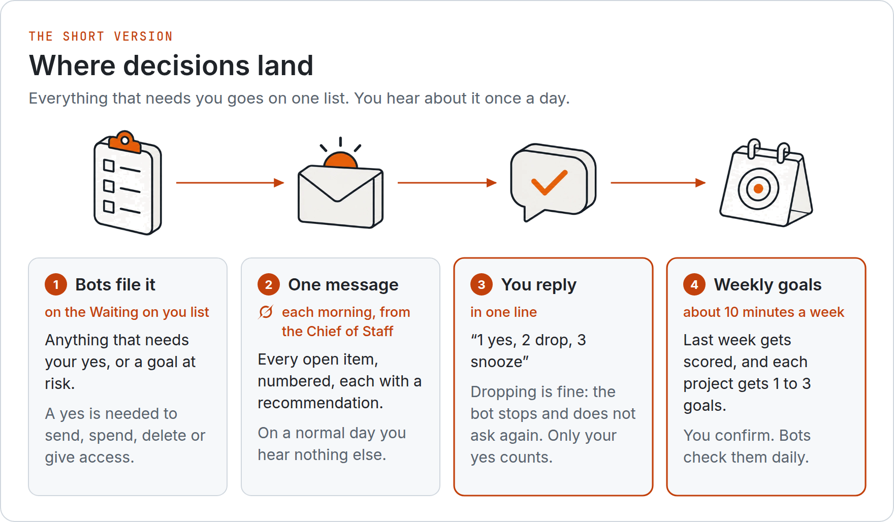
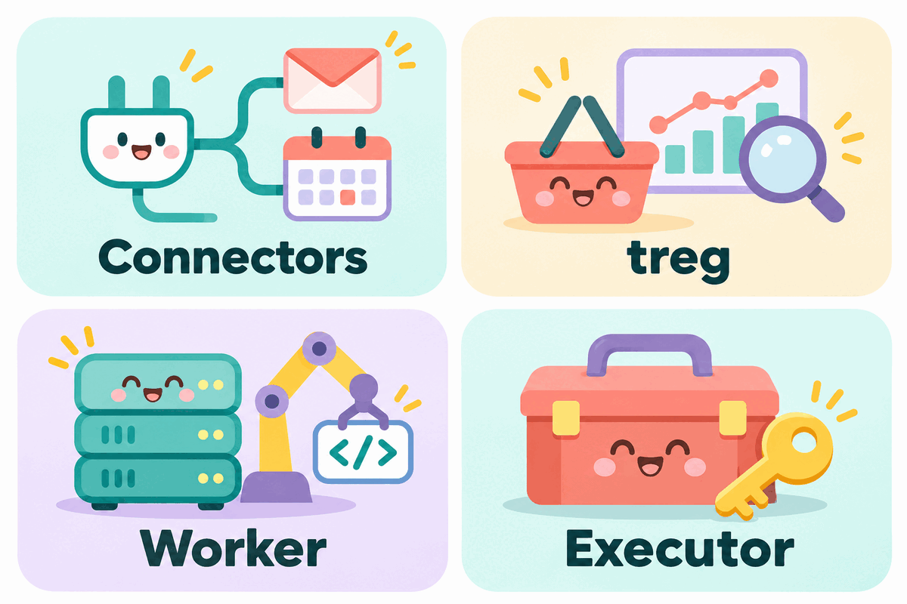

# agent-swarm-kit

**A small team of AI helpers that keeps your projects moving while you get on with your day.** You chat
with a few Grok Bots that plan, remember and ask you only what matters, and an optional always-on worker
does the long, heavy jobs for them on the Claude and ChatGPT subscriptions you already pay for.

> **Easiest start:** tell your Grok Bot
> *"Set me up with this repo: https://github.com/giltotherescue/agent-swarm-kit"*.
> It follows [SETUP-WITH-GROKBOT.md](SETUP-WITH-GROKBOT.md) and walks you through every step, one
> plain question at a time.

## How it works, in four pictures



**Who does what.** You talk to your Grok Bots: a Chief of Staff plus one bot per project. They plan,
draft and keep track. The worker is a rented server that does the long or hard jobs and sends the
result back to the bot that asked.



**A request's journey.** You ask your website bot to refresh the pricing page. The bot writes up the
job, the worker does it with Claude or Codex, and the result goes straight back to that same bot. The
bot checks it and sends you one short message with a link. If the worker gets stuck on a question, the
bot answers it, or asks you if only you can decide.



**Where decisions land.** Anything that needs you goes on one "Waiting on you" list, and the Chief of
Staff sends it to you as one short message each morning. Once a week the Chief of Staff runs a goals
meeting: what each project got done, and one to three clear goals for next week. Between meetings each
project bot checks its goals daily and stays quiet unless a goal is at risk.



**Which tool when.** Grok Bot connectors for your own accounts. treg for paid data without a
subscription, and for some of your private tools like Search Console and Google Ads. The worker for all
coding and anything long. Executor only later, if the worker needs your connected tools too. Short
version below; the full guide is [docs/which-tool-when.md](docs/which-tool-when.md).

## Set it up with your Grok Bot (recommended)

1. Open a chat with the Grok Bot you want as your Chief of Staff (any bot will do; it can be a new one).
2. Say: *"Set me up with this repo: https://github.com/giltotherescue/agent-swarm-kit"*. If the repo is
   private, give the bot read access first, or upload a copy of it.
3. Answer its questions. For each choice it explains the options in a sentence or two and tells you
   what it recommends. Saying "use your recommendation" is always fine.

The bot never asks you to paste a password or key into chat (it uses Grok Bot's secret request form),
and it asks before anything that costs money, like renting a server. Plan on about an hour without a
worker, or an afternoon with one.

## What you get

- **A Chief of Staff bot.** One bot you talk to about everything. It keeps track of what needs you and
  sends you one short list of decisions each morning.
- **A project bot for each project.** A business, a website, an app, your marketing. Each one owns its
  project from end to end and knows its goals, people and limits.
- **A weekly goals meeting and a daily work heartbeat.** Clear goals each week, a quiet daily check, and
  a nudge only when something is stuck.
- **A project log.** Every project, with or without code, keeps a history of what was done, what you
  decided, and your feedback, so bots learn what you like.
- **A worker that does the heavy lifting (optional).** A rented server that runs long jobs, code changes,
  research and anything that needs a strong or specific AI model, while you sleep if you like.
- **Results that come back to the right bot.** When a job finishes, the bot that asked for it gets the
  result directly.
- **One "Waiting on you" list.** Every decision that needs you lands in one place. You can answer, snooze
  or drop each one. Dropping is fine.
- **Light rules.** Nothing goes outside, nothing is deleted, and no money is spent without your yes.
  Everything else just gets done.

## Which tool when (short version)

| Use | For | Examples |
| --- | --- | --- |
| **Grok Bot connectors** | Your own accounts, quick reads and drafts | Gmail, Slack, your calendar, analytics |
| **treg** | Paid data with no subscription, and some private tools it connects to | Keyword and SERP data, contact enrichment, Google Search Console, Google Ads |
| **The worker** | All coding (any size), jobs over about 15 minutes, design, deep research, bulk scraping, a specific model | A pricing page change, a 40-page competitor study, a second-model review |
| **A chain on the worker** | Jobs that run for days as their own orchestrator, in short cycles that hand on a checkpoint ([long-running jobs](docs/long-running-jobs.md)) | A "polisher" that keeps walking the app, fixing bugs and testing again |
| **The bot itself** | Quick lookups, coordination, messages | "What did we decide about the logo?", replying in Slack |
| **Executor** | Later, only if the worker needs your connected tools too | A worker task that must read your CRM |

## Set it up by hand

Prefer to do it yourself? Two paths. You can start with the first and add a worker later; nothing has
to be redone.

### Path A: Grok Bot only (no server, about an hour)

1. Create a Chief of Staff bot. Paste [templates/chief-of-staff.md](templates/chief-of-staff.md) into its
   instructions.
2. Create one project bot. Fill in [templates/project-bot-brief.md](templates/project-bot-brief.md) as its
   brief.
3. Add the routines from [templates/routine-prompts.md](templates/routine-prompts.md): the morning
   decisions, the nightly cleanup, the weekly goals meeting and the daily work heartbeat.
4. Read [docs/grokbot-only.md](docs/grokbot-only.md) for what works, what does not, and how to add a
   worker later.

### Path B: Grok Bot plus a worker (about half a day)

You will type commands on the server. The CLI (command line interface, a program you run by typing) for
the swarm is called `swarmctl`. A token is a long random password that a bot or program uses to prove who
it is. Tailscale is a private network that links your own devices, so nothing has to be open to the
whole internet.

1. Rent an Ubuntu LTS server (4 vCPU, 8 GB to start). See [docs/worker-setup.md](docs/worker-setup.md).
2. Get the kit onto the server. If you have no copy there, download a release file, or pack your own
   copy with `git archive` and send it with `scp` (secure copy). For a private repo, use a read-only key,
   never your own GitHub login. All three ways are in
   [docs/worker-setup.md](docs/worker-setup.md), step 2.
3. If the server gave you only `root`, pick a name for your own admin user (a normal login with sudo).
   The script makes it for you with `--admin-user NAME`. Later steps turn off root login, so you need it.
4. Run the setup script:

   ```bash
   sudo bash scripts/setup-worker.sh --admin-user NAME --tailscale later
   ```

   **Heads up: without `--tailscale later` the script stops at the Tailscale step and waits** (up to
   15 minutes) until you open the link it prints and approve the server. That is fine if you are at the
   screen. With `--tailscale later` nothing waits; you join afterwards with `sudo tailscale up --ssh`.
   `--no-tailscale` skips Tailscale fully, but then public SSH can never be closed (step 7).
5. When the script has finished, log in to Claude Code and Codex as the `agent` user (the user that runs
   the AI jobs), and GitHub as the `swarm-runner` user (the user that pushes code; the jobs themselves
   never get your GitHub login). Then start the worker and run the smoke test (a quick check that
   everything is in place):

   ```bash
   sudo -iu agent claude            # then /login
   sudo -iu agent codex login --device-auth
   sudo -u swarm-runner -H gh auth login
   sudo -u swarm-runner -H gh auth setup-git
   sudo systemctl start swarm-worker
   sudo bash scripts/smoke-test.sh
   ```

   On a new box, expect `0 failed` with up to 2 warnings (GitHub login, Tailscale) until you do those.
6. Join Tailscale if you have not yet, and let your bots reach the worker. The recommended way: put
   Tailscale on your bot's computer and use Tailscale Serve on the worker, so it is never on the public
   internet ([docs/worker-setup.md](docs/worker-setup.md)). Then register each bot's own inbox
   ([templates/bot-setup-checklist.md](templates/bot-setup-checklist.md)).
7. Close public SSH (remote login from the internet) once you can log in as your admin user over
   Tailscale: `sudo bash scripts/setup-worker.sh --lockdown`.
8. Follow the [first week walkthrough](docs/first-week.md) to take one task from start to finish.

**Honest note (tested on):** version 0.3.0 passed a clean install on a fresh Ubuntu 24.04 server on
2026-11-18: setup, smoke test, admin user, firewall and SSH hardening, lockdown refusal checks, an upgrade
by running setup again, the project log, time limits and chains (with a stand-in for the model), and the
task and cleanup flow. Version 0.3.1 fixes the five small defects that run found. Not yet tested on a real
server: joining Tailscale (so the real lockdown, Tailscale Serve and Tailscale SSH), real Claude and Codex
logins and model tasks, GitHub login and repo pushes, and bot notify delivery. Run
`scripts/smoke-test.sh` after setup and tell us what fails.

## Trust model

This kit is for **one trusted owner** (you) running a **dedicated worker** (a server used only for this).
The bots are your own bots. It is not a shared service for strangers. Within that:

- One job on the worker cannot read or change another job.
- A project bot cannot see or act on another bot's jobs, or read another project's log.
- Jobs never hold the worker's long-lived key or your GitHub login. The worker itself pushes code and
  opens draft pull requests after checking the rules.

Details are in [secrets](docs/secrets.md).

## What is in the box

| Folder | What it holds |
| --- | --- |
| [docs/](docs/) | How everything works and how to set it up |
| [templates/](templates/) | Bot instructions, project brief, setup checklist, routine prompts, model routing table, review prompt, task brief |
| [server/](server/) | The task tracker, the worker, the `swarmctl` command line, cleanup, the `with-secrets` helper, service files |
| [scripts/](scripts/) | Setup script for a fresh server, smoke test, backup, disk alert, secret scanner, restart when idle |
| [config/swarm.env.example](config/swarm.env.example) | The one settings file, with placeholders only |
| [tests/](tests/) | Tests: `python3 -m unittest discover -s tests` |

Everything on the server uses only Python 3 and its standard library, with SQLite for storage. There is
no web dashboard on purpose; `swarmctl status` shows what matters on one screen. Running the task tracker
on Cloudflare instead of the worker is a design only, not built.

## Docs

Start with the concepts, then follow your path.

- [Set it up with your Grok Bot](SETUP-WITH-GROKBOT.md): the guided path, every choice explained.
- [Concepts](docs/concepts.md): bots, tasks, states, reports, the Waiting on you list.
- [Which tool when](docs/which-tool-when.md): connectors, treg, the worker or Executor.
- [Goals meeting and work heartbeat](docs/goals-and-heartbeat.md): how bots keep moving each week.
- [Project log](docs/project-log.md): items with status and version, decisions, feedback, and a short rules doc per project.
- [Long-running jobs](docs/long-running-jobs.md): jobs that run for days, as a chain of short cycles.
- [Grok Bot only setup](docs/grokbot-only.md): no server needed.
- [Worker server setup](docs/worker-setup.md): any provider, Tailscale, and the security baseline.
- [Sizing and sandboxes](docs/sizing-and-sandboxes.md): how big a server, and when to offload tests.
- [How it works, technical](docs/how-it-works-technical.md): flow charts and states for developers.
- [Backend](docs/backend.md): the task tracker, its API and who can call what.
- [Results routing](docs/results-routing.md): straight to the owner bot, with a fallback.
- [Model routing](docs/model-routing.md): which model for which job.
- [Approvals](docs/approvals.md): a light default you can loosen.
- [Secrets](docs/secrets.md): the trust model, where keys live, and the `with-secrets` helper.
- [Usage and cost](docs/usage-and-cost.md): keep bots quiet and spend low.
- [Optional services](docs/optional-services.md): GitHub, Tailscale, treg, Executor, email inboxes, the
  multi-subscription proxy.
- [Routines](docs/routines.md): morning decisions, nightly memory cleanup, result handling.
- [First week](docs/first-week.md): one task end to end.
- [Updating the kit](docs/updating-the-kit.md): pull improvements and send yours back.
- [Troubleshooting](docs/troubleshooting.md).

## The rules in one breath

Bots plan, the worker works. Results go to the bot that owns the task. Nothing goes outside, nothing is
deleted, and no money is spent without your yes; another bot's yes does not count. Secrets never go in
chat. Bots stay quiet unless something changed. Anything for you lands on one list, and dropping an item
from it is fine.

## Version

See [VERSION](VERSION) and [CHANGELOG.md](CHANGELOG.md). License: [LICENSE](LICENSE) (private, all rights
reserved).
