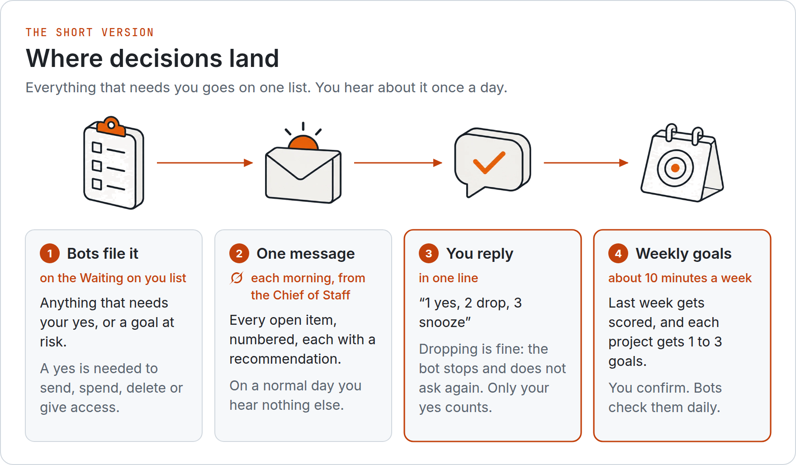

# Goals meeting and work heartbeat

Two habits keep your bots moving without you chasing them: a **weekly goals meeting** that sets one to
three clear goals per project, and a **daily work heartbeat** where each project bot checks its own
goals and stays quiet unless something is stuck.



The copy-paste prompts are in [../templates/routine-prompts.md](../templates/routine-prompts.md)
(prompts 6 and 7). The goals file format is in [../templates/goals.md](../templates/goals.md).

## Two different heartbeats

The word "heartbeat" means two separate things in this kit. They have nothing to do with each other.

| | Work heartbeat | Machine heartbeat |
| --- | --- | --- |
| What it checks | Is each project moving toward its goals? | Is the worker computer alive and is a task still running? |
| Who runs it | Each project bot, as a Grok Bot routine | The worker program, automatically |
| How often | Once a day | Every 30 seconds while a task runs |
| What happens if it is missed | Nothing breaks; a goal may slip unnoticed | After 10 minutes of silence the backend puts the task back in the queue, and the Chief of Staff gets an alert if no worker checks in |
| Costs tokens | A little, once a day per bot | None. It is a plain network call from the worker program to the backend, with no model involved |
| Needs a worker | No | Yes |

The machine heartbeat never runs a model, so it costs nothing however long a task runs, including
chains and long-running jobs ([long-running-jobs.md](long-running-jobs.md)).

This page is about the work heartbeat. The machine heartbeat is described in
[how-it-works-technical.md](how-it-works-technical.md) and [routines.md](routines.md).

## The weekly goals meeting

The Chief of Staff runs it once a week, at a fixed time you pick (for example Monday 9:00). It takes
you about 10 minutes, and most of that is reading.

### What happens

1. **Review last week, per project.** The Chief of Staff reads each project's goals file entry for last
   week, the project log for the last 7 days (results, decisions, feedback), and anything still on the
   Waiting on you list for that project.
2. **Score each goal.** Met, partly met, or missed, with one line of evidence (a link, a number, a task
   result). No excuses, no blame; just what happened.
3. **Propose next week's goals.** One to three per project. Each goal must be checkable, with a
   **"Done means"** line that anyone could verify. A project with nothing important this week gets zero
   goals; that is fine.
4. **You confirm.** You get one message with all projects. You reply "yes", or change a goal in plain
   words ("drop the TikTok one, add a pricing test"). Your reply is the only approval that counts.
5. **Write it down.** The Chief of Staff writes the confirmed goals into the goals file, sends each
   project bot its own goals, and adds one `decision` entry per project to the project log, so the
   history shows what was agreed and when.

### What makes a good goal

A good goal says what will be true at the end of the week, and the "Done means" line makes it
checkable.

| Weak | Better |
| --- | --- |
| Work on SEO | Publish two new blog posts aimed at "budget meal prep". Done means: both live and in the sitemap. |
| Improve the newsletter | Test a shorter subject line. Done means: Thursday's issue sent with it, open rate noted in the log. |
| Fix bugs | Fix the checkout error on mobile Safari. Done means: a merged PR and a test order placed from an iPhone. |

Keep goals to what the bots and the worker can mostly do on their own. A goal that only you can
complete ("call the accountant") belongs on your own list, not here.

### The meeting message

The Chief of Staff sends one message, grouped by project, short enough to read on a phone:

```
Weekly goals, week of 2026-11-23

[marketing]
Last week: 1 met, 1 partly met.
- Met: 2 blog posts live (links). - Partly: newsletter test sent, open rate not logged yet.
Next week:
1. Launch the spring sale email. Done means: sent to the full list, results in the log by Friday.
2. Find 20 low-competition keywords for recipes. Done means: list in the log with volume numbers.

[shop-site]
Last week: 1 missed (checkout fix waiting on your decision about Apple Pay).
Next week:
1. Fix mobile Safari checkout. Done means: merged PR and a real test order.

Reply "yes" to confirm all, or tell me what to change.
```

## The daily work heartbeat

Each project bot runs a short check once a day (for example 10:00, after the morning list). It costs a
little each day, so keep it tight.

### What the bot checks

1. **Is each goal moving?** Look at the project log and task results since yesterday. Something
   happened toward the goal, or work is queued or running for it.
2. **What is blocked?** A task waiting on an answer, a missing login, a failed task.
3. **What did I decide?** Any choice it made on its own yesterday that the human might care about
   gets one `decision` entry in the project log (for example "used the blue banner, the red one
   failed contrast checks").
4. **Read the brief** (`swarmctl log brief PROJECT`: the standing rules plus the last 14 days of
   feedback) before planning new work, so the same note never has to be given twice.

### What the bot does next

- **On track:** do the next piece of work (or queue it on the worker), and **send nothing**. No "all
  good" messages.
- **Blocked by something it can fix:** fix it or queue a follow-up task. Send nothing.
- **A goal is at risk, or it needs a decision:** file one item on the Waiting on you list, with a
  recommendation and a stable key (`goal-PROJECT-WEEK-N`), so it shows up in tomorrow's morning list
  and is never filed twice. It does not message you separately unless it is urgent.

So on a normal day you hear nothing at all, and on a bad day you get one clear decision in the morning
list.

## Where goals live

- **The goals file.** One file the Chief of Staff keeps (in its memory or a shared doc), with one
  section per week and per project. Format: [../templates/goals.md](../templates/goals.md).
- **Each project bot's brief.** "Goals right now" holds this week's goals for that project, copied by
  the Chief of Staff after the meeting.
- **The project log.** A `decision` entry each week with the confirmed goals, plus results, feedback and
  learnings as the week goes. See [project-log.md](project-log.md).

Without a worker (Grok Bot only), all of this still works: the goals file and the project log are notes
the bots keep in their own memory.
