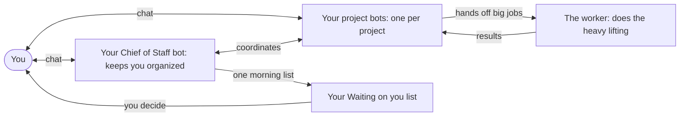
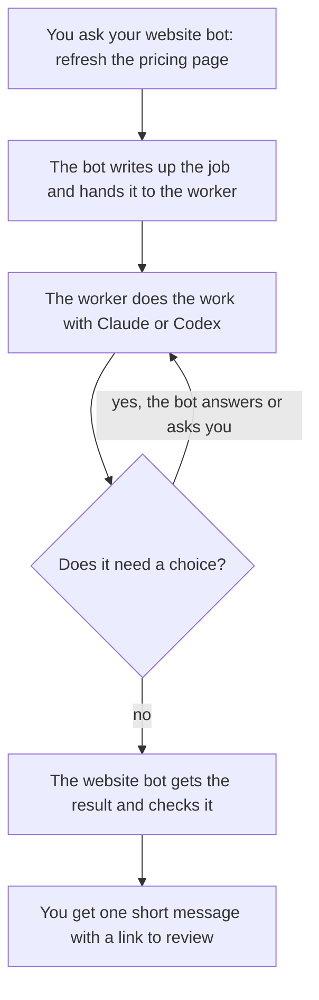
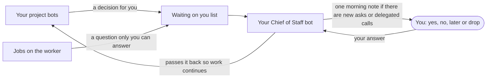
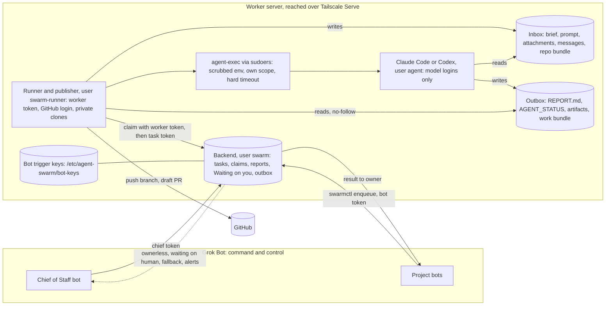
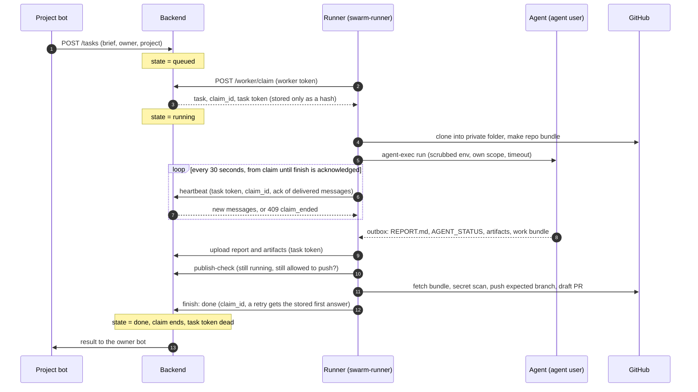
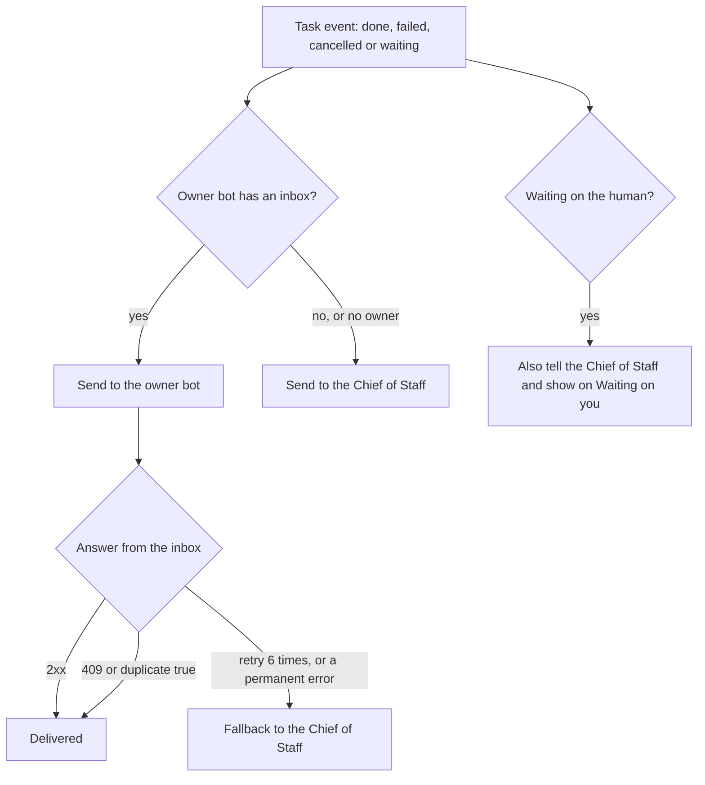
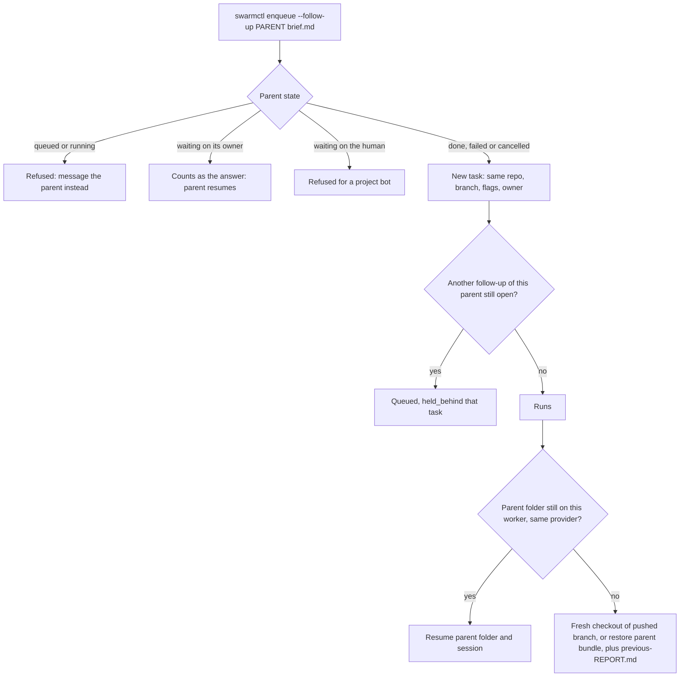
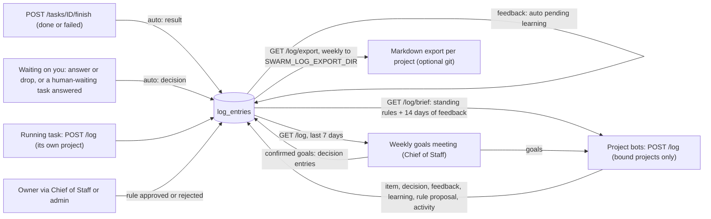
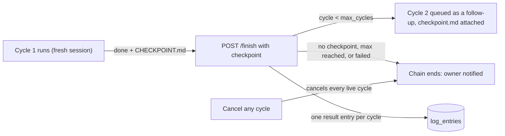

# How it works, technical

This page is for developers. It shows the parts on the worker, who holds which credential, how a task
moves through its states, and how results are routed. The README has the plain product view. For every
API route and who may call it, see [backend.md](backend.md). For secrets and the trust model, see
[secrets.md](secrets.md).

## The product view, as flow charts

These three charts were in the README up to 0.2.1. The README now uses illustrated pictures of the same
ideas; the charts stay here for anyone who likes the boxes and arrows.

### Who does what

Your bots are the managers. They talk with you, plan, and write up jobs. The worker is the doer: it uses
Claude Code and Codex to do the long or hard work.

### A day in the life of a request

The result goes back to the same bot that asked. If the worker gets stuck on a question, that bot
answers it, or asks you if only you can decide. The work then picks up where it stopped.

### Where decisions land

## The parts and who holds what

Key points:

- The `agent` user never holds the worker token or a GitHub credential. It gets a git bundle of the repo
  to clone from, and writes a bundle of its new commits to the outbox.
- The runner never runs git inside the agent's folder. It fetches the agent's bundle into its own private
  clone, scans the added lines for secrets, checks the branch rules with the backend
  (`publish-check`), and pushes to the expected branch only.
- Bot trigger keys live in files, not in the database, so database backups never contain them.

## Tokens

| Token | Who holds it | What it can do |
| --- | --- | --- |
| admin | root, and the Chief of Staff if you choose | everything |
| chief bot (`swb_`) | the Chief of Staff bot | what admin does, except worker and task calls and making tokens |
| project bot (`swb_`) | one project bot | its own tasks, items, bot settings, and projects it is bound to |
| worker | the runner (`swarm-runner`) | claim, task states for cleanup, alerts. Nothing else |
| task (`swt_`) | the runner, for one claim | heartbeat, read its own task and messages, upload its own files, publish-check, finish. Dies when the task leaves `running`, when the lease runs out, or after `SWARM_TASK_TOKEN_MAX_HOURS` |

## The life of a task

Other ways a run ends:

- **Waiting.** `AGENT_STATUS` says `blocked` with a question. Finish with `waiting`. The owner bot gets
  the question (and the Chief of Staff too if it waits on the human). An answer puts the task back in
  `queued`, and the next claim resumes the same folder and session.
- **Next.** `AGENT_STATUS` says `next`. The task goes back to `queued` at once and resumes.
- **Limit.** A usage limit. The worker tries the fallback provider; if there is none, the task waits one
  hour, doubling up to a day.
- **Cancel.** Cancelling a running task is immediate. The claim ends, the next heartbeat gets
  `409 claim_ended`, the runner stops the agent (TERM, then KILL after 20 seconds) and publishes nothing.
- **Reap.** If heartbeats stop for 10 minutes, the backend requeues the task (or fails it after
  `max_attempts`). The old claim is dead, so a late runner cannot finish or upload.

## Where results go

Delivery is at least once. Every payload has `event_id` (also the `Idempotency-Key` header), `event`
(what happened) and `reason` (why this bot got it). Receivers must skip an `event_id` they have already
handled. A 409 answer, or a JSON body with `"duplicate": true`, counts as delivered, so a receiver that
already has the event does not cause a false fallback. Redirects are never followed, and the target
address must be public. Details in [results-routing.md](results-routing.md).

## Follow-ups

## The project log and the weekly loop (0.3.0)

Records that change (items, learnings, rules) are runs of entries sharing a `ref`; the newest entry is
the current state, so nothing is edited in place. A verdict names the item version it judged, and a new
version makes older verdicts stale.

## Chains (long-running jobs)

Every cycle shares `chain_root` (the first cycle's id). See [long-running-jobs.md](long-running-jobs.md).

Auto-entries carry a dedupe key (`task:ID:result`, `item:ID:answer:REVISION`, and so on) in a unique
index per project, so a replayed finish or answer never logs twice. Details and permissions:
[project-log.md](project-log.md).

The work heartbeat (a daily Grok Bot routine per project bot) is separate from the machine heartbeat
(`POST /tasks/ID/heartbeat` every 30 seconds, lease of 600 seconds). See
[goals-and-heartbeat.md](goals-and-heartbeat.md).

## Lifecycle helpers in the backend

- **Reminders.** A task waiting on its owner bot for 12 hours gets one reminder. After 24 hours it is
  filed once on Waiting on you and the Chief of Staff is told.
- **Watchdog.** Tasks queued but no worker has checked in for 10 minutes: one alert. A task running past
  its timeout plus 30 minutes: one alert per claim.
- **Drain.** `sudo swarmctl drain` stops new claims; `sudo swarmctl restart-when-idle` waits until no
  task runs, then restarts the worker.
- **Retention.** Files of tasks finished more than 90 days ago, and sent notices older than 30 days, are
  deleted daily.

## Optional: Cloudflare (design only, not built)

Running the backend on Cloudflare Workers with D1 is a design only. Nothing for it ships in this kit.
See [backend.md](backend.md).
