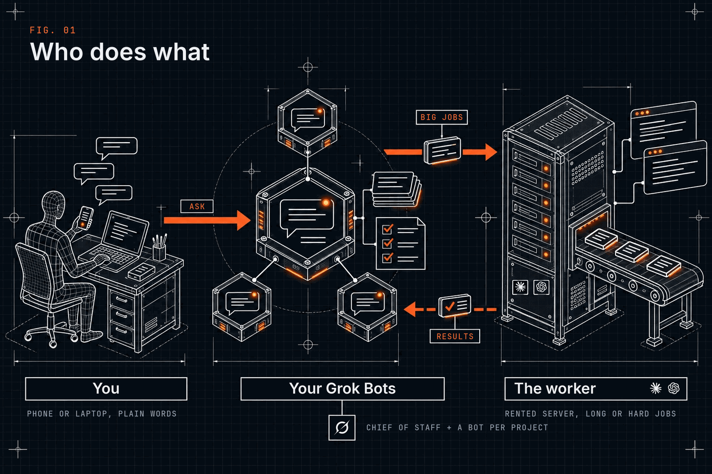
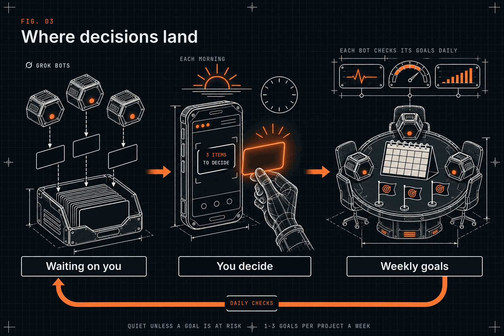

# How it works, in four pictures

The long version of the four diagrams in the [README](../README.md#how-it-works-in-four-pictures).
For flow charts and states, see [how-it-works-technical.md](how-it-works-technical.md).

## Who does what

You talk to your Grok Bots: a Chief of Staff plus one bot per project. They plan, draft and keep
track. The worker is a rented server that does the long or hard jobs with Claude or Codex, and
sends the result back to the bot that asked.

## A request's journey

You ask your website bot to refresh the pricing page. The bot writes up the job, the worker does it
with Claude or Codex, and the result goes straight back to that same bot. The bot checks it and
sends you one short message with a link. If the worker gets stuck on a question, the bot answers it,
or asks you if only you can decide. More in [results-routing.md](results-routing.md).

## Where decisions land

Anything that needs you goes on one "Waiting on you" list, and the Chief of Staff sends it to you as
one short message each morning. Once a week the Chief of Staff runs a goals meeting: what each
project got done, and one to three clear goals for next week. Between meetings each project bot
checks its goals daily and stays quiet unless a goal is at risk. More in
[approvals.md](approvals.md) and [goals-and-heartbeat.md](goals-and-heartbeat.md).

## Which tool when

Grok Bot connectors for your own accounts. treg for paid data without a subscription, and for some
of your private tools like Search Console and Google Ads. The worker for all coding and anything
long. Executor only later, if the worker needs your connected tools too. The full guide is
[which-tool-when.md](which-tool-when.md).
