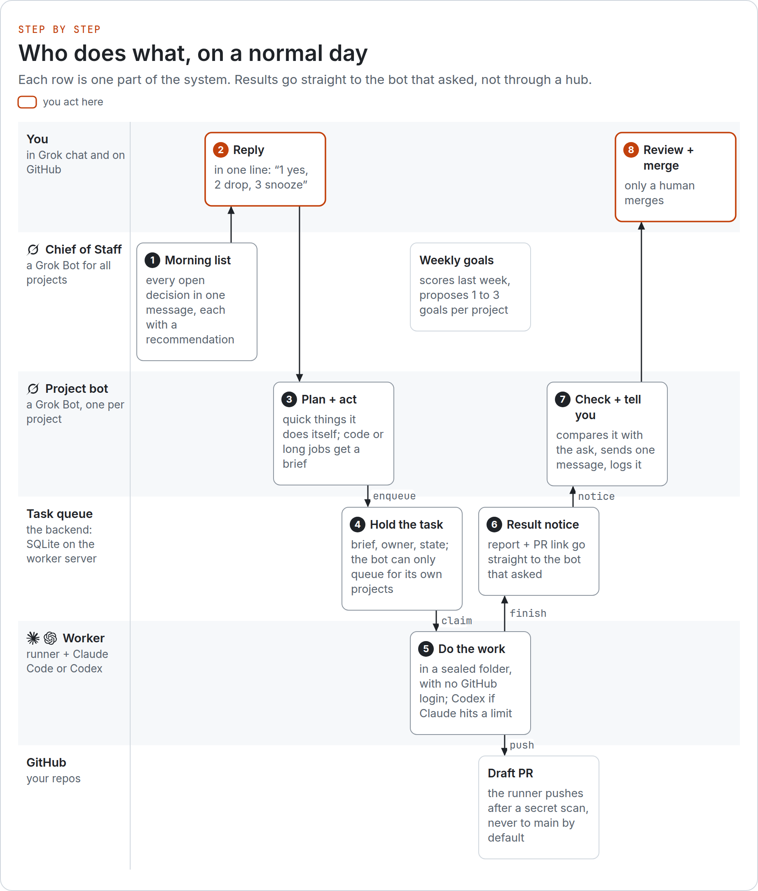
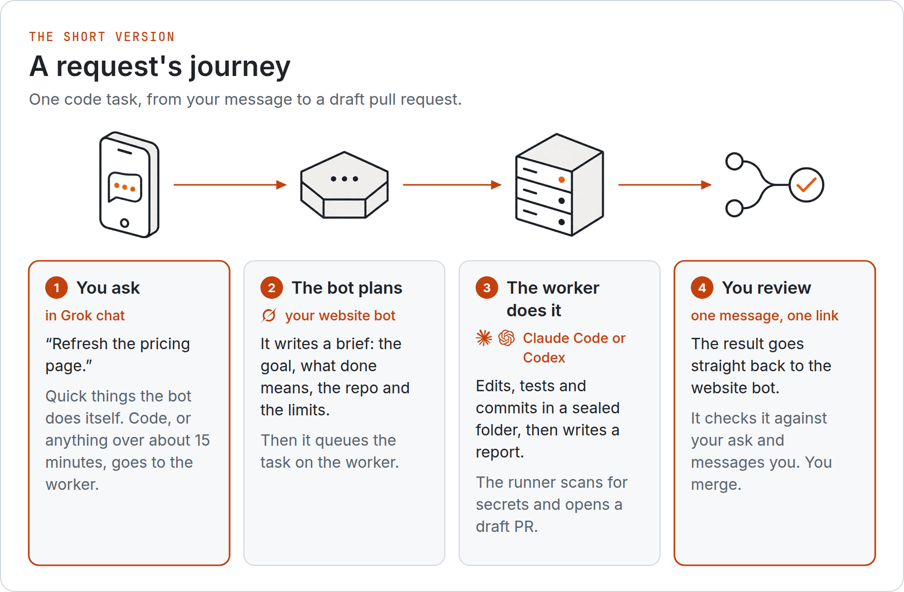
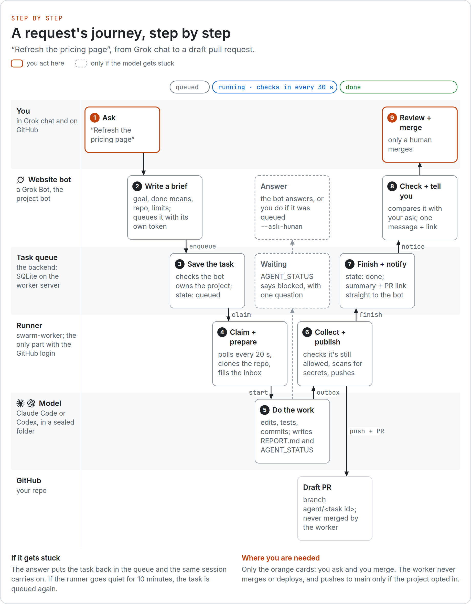
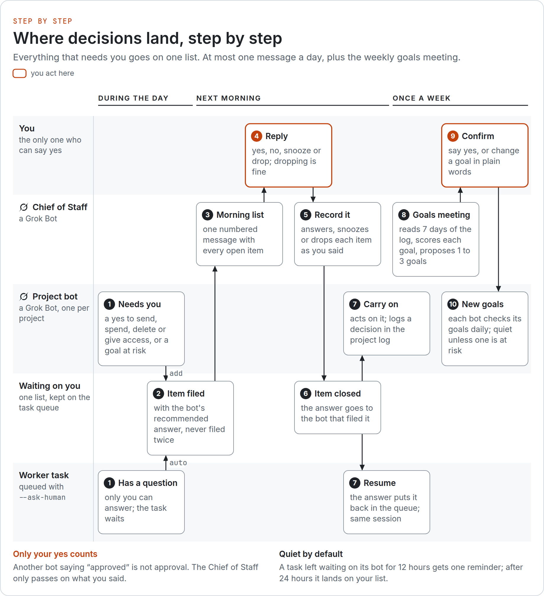
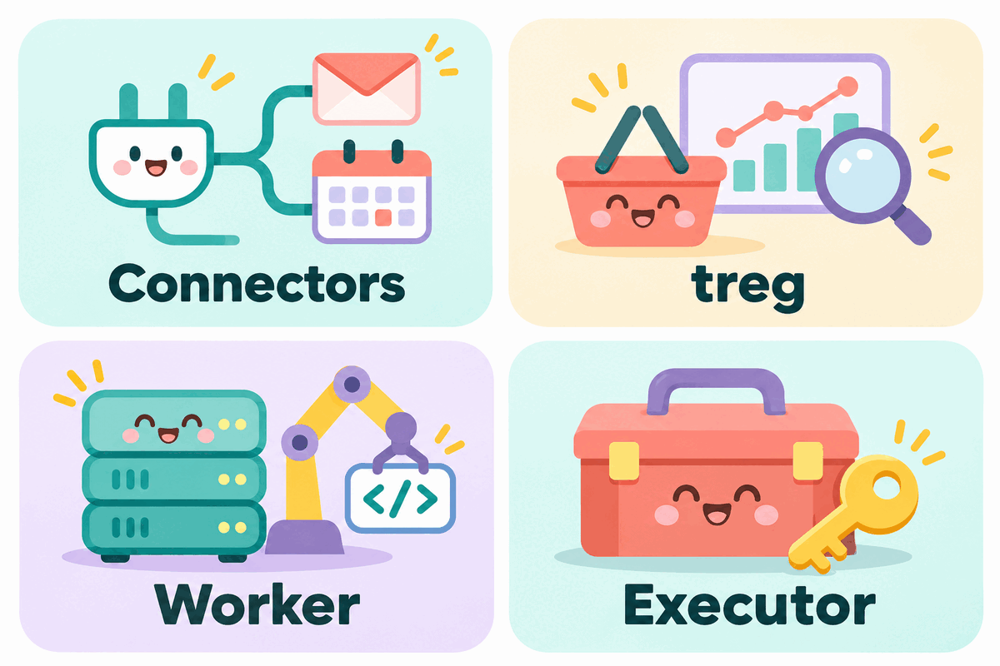
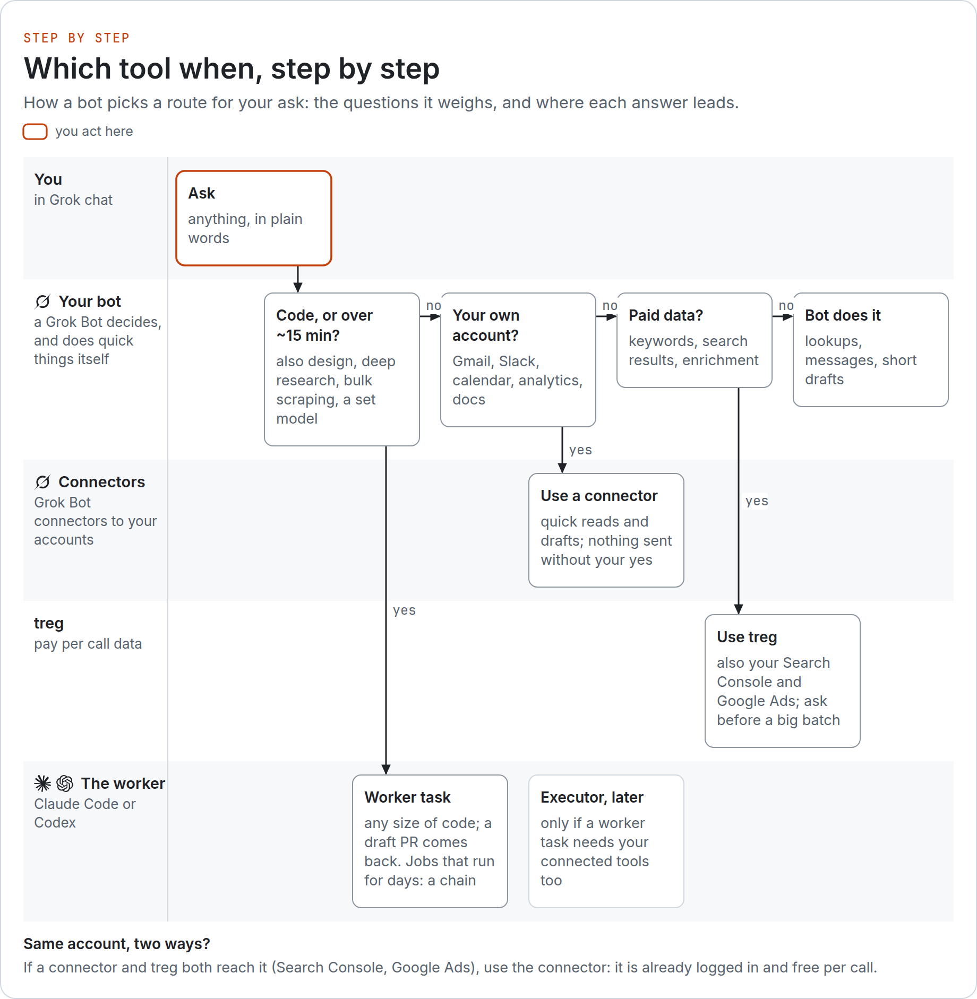

# How it works, in four pictures

The long version of the four diagrams in the [README](../README.md#how-it-works-in-four-pictures):
each topic has the short picture, then a step-by-step swimlane. Orange outlines are the only places
you act, and dashed cards are the "model gets stuck" loop.
For flow charts and states, see [how-it-works-technical.md](how-it-works-technical.md).

## Who does what

You talk to your Grok Bots: a Chief of Staff plus one bot per project. They plan, draft and keep
track. The worker is a rented server that does the long or hard jobs with Claude or Codex, and
sends the result back to the bot that asked.

## A request's journey

You ask your website bot to refresh the pricing page. The bot writes up the job, the worker does it
with Claude or Codex, and the result goes straight back to that same bot. The bot checks it and
sends you one short message with a link. If the worker gets stuck on a question, the bot answers it,
or asks you if only you can decide. More in [results-routing.md](results-routing.md).

## Where decisions land

Anything that needs you goes on one "Waiting on you" list. The Chief of Staff sends one short morning
note for new asks and [delegated calls](delegated-decisions.md) you can overrule. No change means no note.
Once a week the Chief of Staff runs a goals meeting: what each
project got done, and one to three clear goals for next week. Between meetings each project bot
checks its goals daily and stays quiet unless a goal is at risk. More in
[approvals.md](approvals.md) and [goals-and-heartbeat.md](goals-and-heartbeat.md).

### The morning review call

You do not have to answer the morning list by typing. The Chief of Staff rolls up every open question
and action item from overnight and the previous day into that one list. You can then start a voice
conversation with the Chief of Staff in the Grok Bot app and go through the items back and forth,
hands free, for example on a drive. Ask what an item is about, push back on a recommendation, or
just say "yes", "snooze" or "drop it".

When the call ends, the Chief of Staff does the same as for a typed reply: it writes each answer to
its item on the Waiting on you list (answered, snoozed or dropped), which also logs it as a decision
for that project, and it messages the project bots so they get back to work. If a worker task was
waiting on one of those answers, it goes back in the queue and carries on. Only what you actually
said counts as your yes.

## Which tool when

The swimlane shows the questions a bot weighs for each ask, not a fixed checklist. Grok Bot
connectors for your own accounts. treg for paid data without a subscription, and for some of your
private tools like Search Console and Google Ads. The worker for all coding and anything
long. Executor only later, if the worker needs your connected tools too. The full guide is
[which-tool-when.md](which-tool-when.md).
