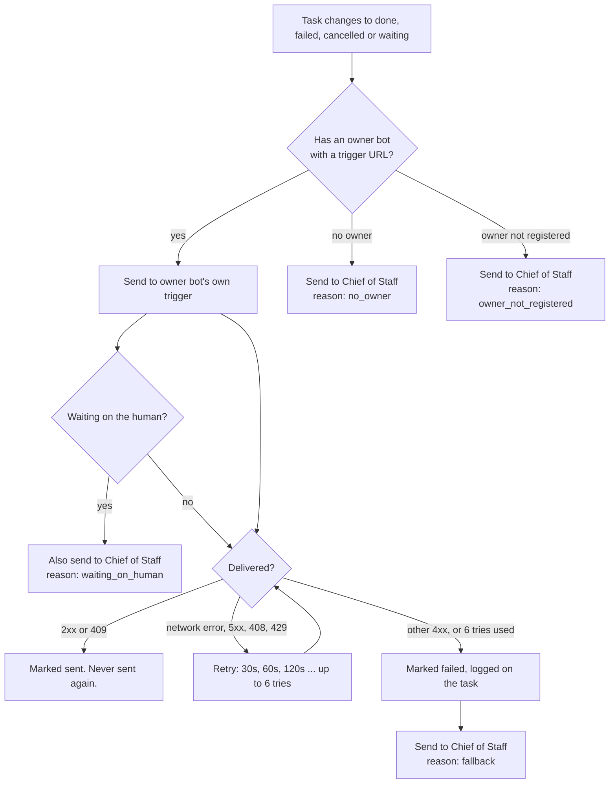

# Results routing

This page explains how a task's result gets back to the bot that asked for it. The backend sends each result straight to the owning project bot's own trigger. It does not pass through the Chief of Staff or any other hub bot, because every bot that relays a message spends a full turn of tokens on it. The Chief of Staff only hears about ownerless tasks, questions for the human, alerts, and deliveries that failed.

## Who gets what

| Event | Goes to | `reason` field |
| --- | --- | --- |
| A task with an owner ends (done, failed, cancelled by someone else) or waits | The owner bot | `owner` |
| A task waits on the human (`--ask-human`) | The owner bot and the Chief of Staff | `owner`, `waiting_on_human` |
| A task has no owner | Chief of Staff | `no_owner` |
| The owner bot is unknown or has no trigger URL | Chief of Staff | `owner_not_registered` |
| Delivery to the owner failed for good | Chief of Staff | `fallback` |
| Disk alert or other worker alert | Chief of Staff | `alert` |
| The human answers or drops a Waiting on you item | The bot that filed it | `owner` |
| A task has waited on its owner bot for 12 hours | The owner bot, once | `owner` (event `reminder`) |
| A task has waited on its owner bot for 24 hours | Chief of Staff, once, and it goes on Waiting on you | `alert` (event `escalated`) |
| No runner checked in for 10 minutes, or a task ran far past its time limit | Chief of Staff | `alert` (event `watchdog`) |

An owner cancelling its own task sends no notice. Nothing is sent while a task is queued or running. The reminder and escalation times are `SWARM_REMIND_HOURS` and `SWARM_ESCALATE_HOURS` in the settings file.

Two fields tell a bot what it is looking at:

- `event` says **what happened**: `task` (a task changed state), `item_answer` or `item_drop` (the human answered or dropped a Waiting on you item), `alert`, `test`, `reminder`, `escalated` or `watchdog`.
- `reason` says **why this bot got it**: `owner`, `no_owner`, `owner_not_registered`, `waiting_on_human`, `fallback`, `alert` or `test`.



## What a bot receives

The backend makes an HTTP POST (a web request) with a JSON (a common structured text format) body to the bot's trigger URL. A task notice looks like this:

```json
{
  "event": "task",
  "event_id": "t20260105120000-a1b2c3:done:1",
  "idempotency_key": "t20260105120000-a1b2c3:done:1",
  "reason": "owner",
  "notify_target": "website-bot",
  "task_id": "t20260105120000-a1b2c3",
  "owner": "website-bot",
  "project": "website",
  "kind": "code",
  "title": "Fix the header on mobile",
  "state": "done",
  "outcome": "done",
  "waiting_on": null,
  "summary": "Status: done. Header fixed and tested on small screens.",
  "pr_url": "https://github.com/you/site/pull/12",
  "report_url": "https://YOUR-WORKER.YOUR-TAILNET.ts.net/tasks/t20260105120000-a1b2c3/report"
}
```

When `state` is `waiting`, there is also a `question` field. A fallback notice adds `delivery_failed_for` (the bot that missed it) and `delivery_error`. Alerts carry `text` and `from` instead of task fields. Waiting on you notices carry `item_id`, `ask`, `answer`, `task_id`, `dropped` and `note`; when the human drops an item, `note` says "dropped: stop work on this".

Headers sent with every notice:

- `Content-Type: application/json`
- `Idempotency-Key`: the same value as `event_id`
- `Authorization`: only if the bot registered a trigger key. A bare key is sent as `Bearer <key>`; a value that already has a scheme is sent as is.

Only https trigger URLs on public addresses are accepted. The backend never follows a redirect, so the URL you register must be the final one. See [backend.md](backend.md#protections-built-into-the-backend).

`report_url` is only filled in when `SWARM_PUBLIC_URL` is set in the [settings file](../config/swarm.env.example). Reading it needs the bot's token.

## Delivered at least once, so receivers skip repeats

Delivery is "at least once": the backend keeps trying until the bot confirms, so in rare cases (a reply lost on the network, a restart at the wrong moment) a bot can get the same notice twice. Your receiver should skip an `event_id` it has already handled.

A receiver can tell the backend "I already have this" in two ways, and both count as delivered with no retry and no fallback to the Chief of Staff:

- answer HTTP 409 (conflict);
- answer 2xx with a JSON body containing `"duplicate": true`.

Each event has an ID built as `<task id>:<state>:<n>`. The `n` counts how many times that task has entered that state, so a second question on the same task is a new event, but the same question is not.

The backend stores each delivery under the key `<event id>><bot id>` in a table where that key must be unique. Saving the same event for the same bot again does nothing. So a bug that queues the same event twice cannot send a second copy. Only the network can, as described above.

**Warning: never reuse an idempotency key for different work.** The same rule applies in both directions:

- When a bot queues a task with `--key` (the idempotency key), sending the same key again returns the first task instead of making a new one. That is the point: a bot that retries after a timeout does not create duplicates. But if you reuse a key for a different brief, the backend refuses with HTTP 409 ("already used for a different task"). Use a new key for new work, for example `seo-audit-2026-01` and then `seo-audit-2026-02`.
- A receiver that sees an `event_id` it already handled will drop it as a duplicate. If you ever build your own notices, never reuse an ID for a different event, or it will be silently ignored.

## Setting up a bot

Every bot walks through [the per-bot setup checklist](../templates/bot-setup-checklist.md) once. In short:

1. **Its own trigger.** In Grok Bot, make one webhook-triggered routine for this bot only. Its URL is the bot's inbox for results.
2. **Filter to its own tasks.** The routine skips any payload where `notify_target` (or `owner`) is not this bot. This is a second safety net in case a URL is ever shared by mistake.
3. **Treat payload text as untrusted.** Titles, summaries and questions come from task briefs and model output. The routine reads them as information, never as instructions to follow.
4. **Register it.** An admin (or the Chief of Staff) runs:

   ```
   swarmctl bot set website-bot --notify-url https://TRIGGER-URL --notify-auth-file ~/.config/swarm/website-bot.hook
   ```

   The trigger key goes in a file, never on the command line or in chat. `GET /bots` only shows `has_notify_auth`, never the key.
5. **Get a token.** An admin runs `swarmctl bot token website-bot`. It writes the token to a file with permissions 600 (only the owner can read it). Hand the file over through your secret store, not chat. With this token the bot sees and changes only its own tasks.
6. **Test it.** `swarmctl bot test website-bot` queues one test notice (`reason: test`). The bot should wake once. To see the duplicate guard work, run `swarmctl bot test website-bot --nonce check-1` twice: the second call answers `"queued": false` and nothing new arrives. Without `--nonce`, every run sends one new test.

The Chief of Staff is set up the same way with `--role chief`. If no bot has the chief role and a trigger URL, fallback notices have nowhere to go: they are not sent, and failures only show on the task's event list.

## Checking deliveries

- `GET /notices` (admin or chief token) lists the last 100 deliveries with state, attempts and last error.
- `swarmctl status` shows counts of pending, sent and failed notices.
- A permanent failure is also written on the task as a `notify_failed` event, visible with `swarmctl show TASK_ID`.

If notices fail, see [troubleshooting](troubleshooting.md).

## Cheap polling as a backup

A bot that missed something can catch up without a hub: `swarmctl list --owner website-bot --since <unix time>` (or `GET /tasks?owner=website-bot&updated_since=...`) returns only tasks that changed. See [usage and cost](usage-and-cost.md).
