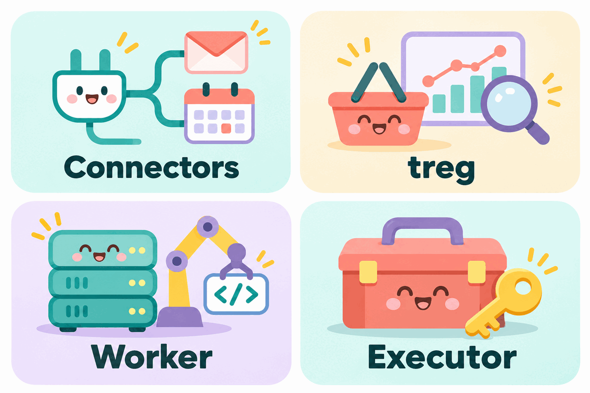

# Which tool when

Your bots can get work done in five ways. This page says which one to reach for, with examples. When
in doubt: quick things stay with the bot, and anything that is coding or takes a while goes to the
worker.

## The short answer

| Route | Use it for | Do not use it for |
| --- | --- | --- |
| **The bot itself** | Quick lookups, coordination, messages, short drafts | Anything over about 15 minutes, any coding |
| **Grok Bot connectors** | Your own accounts: Gmail, Slack, calendar, analytics, docs | Data you do not own, bulk pulls |
| **treg** | Paid data without a subscription (SEO, search results, enrichment), and your own private tools it connects to, like Google Search Console and Google Ads | Accounts a connector already covers well, big batches without asking |
| **The worker** | All coding of any size, jobs over about 15 minutes, design, deep research, bulk scraping, work that should run on a specific model | Quick replies, chat, anything that needs you right now |
| **A chain on the worker** | Jobs that run for days and steer themselves, as short cycles that each hand a checkpoint to the next | One-off tasks; anything you want to watch step by step |
| **Executor** | Later: when a worker task needs one of your connected tools too | Day one. Skip it at first |

## The bot itself

Your Grok Bots are the managers. They are fast and they already know the project, so short things are
cheapest right there.

Examples:
- "What did we decide about the logo last week?" (it reads its notes and the project log)
- Replying to a Slack thread, or drafting a two-paragraph email.
- Turning your voice note into a to-the-point brief for the worker.
- Checking whether yesterday's worker result matches what you asked for.

## Grok Bot connectors

Connectors plug a bot into your own accounts. Give each bot only the connectors its project needs.

Examples:
- **Gmail:** find the last three emails from a client and draft a reply (a draft until you say send).
- **Slack:** summarize what the team said about the launch today.
- **Calendar:** find a free hour for the goals meeting next week.
- **Analytics:** how many signups came from the newsletter this month.

## treg

treg is pay per call. A bot buys one lookup when it needs it, so you do not pay monthly for a tool you
use twice. It also connects to some of your own private tools, so it is a second way to reach accounts
like Google Search Console and Google Ads.

Examples:
- **SEO data:** search volume and difficulty for 50 keywords before writing a blog plan.
- **Search results (SERP):** who ranks in the top 10 for "best running shoes for flat feet" today.
- **Enrichment:** company size and role for a list of 30 leads.
- **Your Google Search Console:** which pages lost clicks this month.
- **Your Google Ads:** cost per signup by campaign for the last 30 days.

Treat treg like spending money: put a monthly cap in the project brief, and have bots ask before big
batches.

### Connector or treg for the same account?

Some accounts, like Google Search Console or Google Ads, can be reached either way. Pick by the job:

| Pick the connector when | Pick treg when |
| --- | --- |
| The bot already has the connector and it covers what you need | There is no connector for that account in Grok Bot, or it is missing the report you need |
| You want quick, everyday reads ("how did yesterday go?") | You want the account's numbers next to paid data in one pull (your Search Console clicks next to keyword volumes) |
| You want to draft or act inside the account | A worker task needs the data, since treg works the same from a bot or a task |

If both work, use the connector: it is already logged in and costs nothing per call.

## The worker

The worker is the doer. **All coding goes to the worker, whatever the size**, even a one-line fix:
it works on a branch, runs the tests, and opens a draft pull request you can review. Anything that would
take a bot more than about 15 minutes goes there too.

Examples:
- **Coding:** fix the typo on the pricing page; add a "remember me" box to the login form; upgrade the
  framework.
- **Long jobs:** a 40-page competitor study; checking 2,000 product listings for broken links.
- **Design:** a new landing page layout, illustrations, ad graphics.
- **Deep research:** "what do small gyms pay for booking software, with sources".
- **Bulk scraping:** pull every public price from five competitor sites into a spreadsheet.
- **A specific model:** strategy or a big decision on Opus; a second model (Codex if Claude did the
  work, or the other way round) as a cross-check or code review. The routing table in
  [model-routing.md](model-routing.md) says which model for which job.

The bot writes the brief, queues it, and gets the result back in its own inbox. You hear about it only
when there is something to look at or decide.

**Jobs that run for days.** Some jobs are their own orchestrator, like a "polisher" that keeps walking
through the app, fixing bugs and testing again. Run those as a **chain**: each cycle is a short run that
writes a checkpoint and queues the next cycle, so a stuck cycle costs little, and cancelling any cycle
stops the whole chain. A single long run with a bigger time limit is possible too, but it is not the
default. See [long-running-jobs.md](long-running-jobs.md).

## Executor

Executor keeps logins for your own tools and MCP servers in one safe place, so the worker can use them
too. Most people never need it.

Examples of when it starts to make sense:
- A worker task must read your CRM to write personalized follow-ups.
- A long research job on the worker needs your internal database.

**Skip it at first.** Add it when a worker task keeps getting stuck because it cannot reach a tool your
bots can.

## Quick decision path

1. Is it coding, or will it take more than about 15 minutes? **Worker.**
2. Does it need a specific model (Opus for strategy, a second model to check)? **Worker.**
3. Is it in one of your own accounts? **Connector** (or treg if there is no connector for it).
4. Is it paid data you do not subscribe to? **treg**, within the project's cap.
5. Otherwise: **the bot does it itself.**
